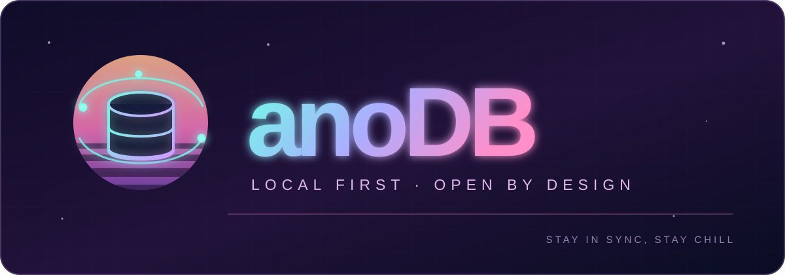

<p align="center">
  
</p>

<h1 align="center">anoDB — Absolutely No DB</h1>

<p align="center"><strong>A decentralized, local-first database.</strong><br />Zero servers to run. Zero servers to trust.</p>

<p align="center">
  <a href="https://www.npmjs.com/package/@anodb/core"></a>
  <a href="https://www.npmjs.com/package/@anodb/cli"></a>
  <a href="LICENSE"></a>
</p>

anoDB is a decentralized, local-first database SDK that treats on-device SQLite as the source of truth and distributes changes as **end-to-end encrypted Nostr events** through existing public relays.

True to its name, it requires **absolutely no developer-operated server**: no API server, no database server, and no project setup. Offline reads and writes, multi-device sync, sharing with other people, and reading/writing public Nostr data are available through a single type-safe, SQL-like API.

> **Status: v0.9 / experimental.** The protocol ([PROTOCOL.md](PROTOCOL.md), v2) may change incompatibly. See [docs/DESIGN.md](docs/DESIGN.md) for design details and limitations, and [docs/DECISIONS.md](docs/DECISIONS.md) for the decision log.

## Features

- 📴 **Offline-first** — Writes commit immediately to local SQLite. The network catches up later.
- 🧾 **Type-safe SQL** — A [Kysely](https://kysely.dev) query builder with JOINs, plus raw SQL writes (`UPDATE … LIKE`, `INSERT … SELECT`, upserts) that are captured and synced.
- 👥 **Sharing** — Spaces with owner / admin / writer / reader roles, invitations by npub or one-time links, removal with cut-offs, key rotation.
- 🔐 **Secure by default** — Writes are signed by per-device keys, keys are stored encrypted, relays see only throwaway pubkeys and rotating tags, and new members never see deleted history.
- 🔀 **Deterministic merging** — Cell-level Last-Writer-Wins with Hybrid Logical Clocks; tolerant of out-of-order delivery, duplicates and retries.
- ⚡ **Direct device-to-device sync** — Your devices connect over WebRTC ([nostr-p2p](https://github.com/sho-ritz/nostr-p2p)) and exchange changes in tens of milliseconds; relays remain the store for offline devices.
- 🔁 **4-layer sync** — NIP-77 Negentropy, time-based fallback, sequence-gap detection, snapshots. A durable outbox retries until `minAcks` relays acknowledge.
- 🌐 **Nostr tables** — Profiles, notes, follows, reactions and long-form articles as SQL tables, readable and writable by any Nostr client.
- 📎 **Encrypted files** — Large files go to [Blossom](https://github.com/hzrd149/blossom) servers, encrypted on the device; only a reference is stored in the database.
- 🔏 **Row ownership** — rows belong to their creator: others can’t edit, delete or impersonate them (checked on every device); `createdBy` / `updatedBy` come from signatures. `shared()` tables for collaboration.
- ⚛️ **React** — `useQuery`, `useSyncStatus`, and ready-made `<PairDevice />`, `<InviteLink />`, `<JoinSpace />`, `<Members />` components.

## Get started

In an existing app (Next.js, Vite, SvelteKit, Tauri, Electron, Expo or Node):

```sh
npx @anodb/cli init
```

One interactive command does the whole setup:

1. Asks the language (English / 日本語) and detects your environment and framework
2. Installs `@anodb/core` (plus `sql.js` for web apps)
3. Generates `anodb/schema`, `anodb/db` and a React `<DBProvider>`
4. Web apps: copies the SQLite WASM files to `public/anodb/` and adds `"postinstall": "anodb assets"` to keep them in sync
5. Wraps your app in `<DBProvider>` (Next.js `app/layout` or Vite `src/main`)
6. Optionally checks that the relays store and serve events

Then use it from any component:

```tsx
import { useAnoDB, useQuery } from '@anodb/core/react'

const db = useAnoDB()
const todos = useQuery((db) => db.selectFrom('todo').selectAll(), [])
await db.insertInto('todo').values({ title: 'Milk', done: false }).execute()
```

No bundler configuration, no server, no account. Keys are generated on each user's device on first
launch. Only one tab per origin opens the database; other tabs get `AnoDBError('tab-locked')`.

### Packages

The product is **anoDB**; on npm it lives under the `@anodb` scope.

| Package | What it is |
|---|---|
| [`@anodb/core`](https://www.npmjs.com/package/@anodb/core) | The database: sync, sharing, keys, files, React hooks (`@anodb/core/react`) and Node driver (`@anodb/core/node`) |
| [`@anodb/cli`](https://www.npmjs.com/package/@anodb/cli) | `npx @anodb/cli init` — the setup wizard (you never import it) |
| [`nostr-p2p`](https://www.npmjs.com/package/nostr-p2p) | WebRTC over Nostr signaling, used internally by `@anodb/core` |

### Manual setup

```sh
npm install @anodb/core sql.js   # sql.js only for browsers / Tauri
npx anodb assets                 # copy the SQLite WASM files to public/anodb/
```

```ts
import { browserDriver, createAnoDB } from '@anodb/core'
const db = await createAnoDB({ appId, schema, driver: await browserDriver({ name: appId }) })
```

Runs in browsers / Tauri (sql.js persisted to IndexedDB), Electron and Node.js 22.13+ (`node:sqlite`), and React Native / Expo (`expo-sqlite`).

## Usage

```ts
import { createAnoDB, defineSchema } from '@anodb/core'

const schema = defineSchema({
  todo: { title: 'text', done: 'boolean', priority: 'integer', meta: 'json' },
  tag: { name: 'text', todoId: 'text' },
})

const db = await createAnoDB({ appId: 'com.example.todo', schema, driver })

// SQL-like and type-safe, JOINs included
await db.insertInto('todo').values({ title: 'Buy groceries', done: false }).execute()
await db.updateTable('todo').set({ done: true }).where('title', 'like', '%groceries%').execute()
const rows = await db
  .selectFrom('todo')
  .leftJoin('tag', 'tag.todoId', 'todo.id')
  .select(['todo.title', 'tag.name'])
  .execute()

// Raw SQL works too; writes are captured by triggers, encrypted and synced
await db.execute('UPDATE todo SET done = 1 WHERE priority > ?', [2])

// Transactions (atomic locally, one sync unit)
await db.transaction().execute(async (tx) => {
  await tx.insertInto('todo').values({ title: 'A' }).execute()
})

// Live queries: re-run on local or remote changes
const stop = db.subscribe(db.selectFrom('todo').selectAll(), (rows) => render(rows))
```

- Every table gets `id`, `space`, `createdAt` and `updatedAt` (`space` defaults to your personal space).
- `boolean` columns read as `true / false` and `json` columns as parsed values (also through JOINs, aliases and live queries). Raw SQL strings (`db.execute`) return plain SQLite values.

### Keys (most secure defaults)

| Environment | Default key store |
|---|---|
| Browser / Tauri | IndexedDB, sealed with a non-extractable WebCrypto key |
| Node | Environment variables (`npx @anodb/cli init` writes only the device key and delegation to `.env`, never the identity key) |
| Electron / Expo | `electronKeyStore(safeStorage)` / `secureStorageKeyStore(expo-secure-store)` |

- Every write is signed by a **device key**; the identity key is used once to register the device.
- With `identity: 'recovery'`, the identity key is handed to `onRecoveryKey` once and never stored on the device.
- External signers: `signer: nip07Signer() | nip46Signer(uri) | nip55Signer(bridge)`.
- Relays see only throwaway pubkeys, per-epoch tags, times and sizes (`metadataProtection: 'none'` turns this off for allow-listed relays).

## Sharing (spaces)

```ts
const family = await db.createSpace('Family')
await db.insertInto('todo').values({ title: 'Milk', space: family }).execute()

// Invite by npub (the invitee publishes a key package first: db.publishKeyPackage())
await db.invite(family, 'npub1alice…', 'writer')        // owner / admin / writer / reader
// Invitee: nothing syncs until they accept
alice.onInvitation((i) => …); await alice.acceptInvitation(i.space)

// One-time, expiring invite link; an admin must approve each request
const link = await db.createInviteLink(family, { role: 'reader', expiresInMs: 86_400_000 })
db.onJoinRequest((req) => db.approveJoinRequest(req.id))

await db.setRole(family, who, 'reader')
await db.removeMember(family, who)
```

- **Rows belong to the member who created them.** Others can't edit or delete them, and can't
  create rows in someone else's name. Every device enforces this when it applies a change, so a
  modified client gets nowhere. Admins and the owner may delete (moderate) but not edit. Each
  row has `createdBy` and `updatedBy` (identities taken from signatures, read-only). Mark
  collaborative tables with `shared(...)` so that any writer can change any row:

  ```ts
  import { defineSchema, shared } from '@anodb/core'
  defineSchema({
    messages: { text: 'text' },                          // only the author can edit / delete
    items: shared({ title: 'text', done: 'boolean' }),   // anyone in the space can tick items
  })
  // "one row per member" pattern: use your identity as the id — only you can write it
  await db.insertInto('profiles').values({ id: db.pubkey, name: 'Taro', space }).execute()
  ```
- New members receive **only a snapshot of the current state** — no edit history and no deleted content.
- Group keys rotate on member removal, device revocation, member addition and every 30 days.
- After removal, writes beyond each device's sequence-number cut-off are rejected (backdating does not help).

### Adding and revoking devices

```ts
// New device: show a QR code
const offer = await newDevice.startPairing()   // render offer.uri as QR, show offer.code
await offer.done; await newDevice.close()      // reopen: it now has the same identity
// Existing device: scan, compare the code, approve (the identity key is never copied)
const req = db.parsePairing(uri); /* check req.code */ await req.approve('Laptop')

await db.revokeDevice(lostDevicePubkey)        // lost or stolen device
```

> ⚠ Group keys are delivered to device keys only. **If you lose every device, your personal space cannot be recovered** (shared spaces can be restored by other members). Register at least two devices.

## Public Nostr data (tables)

```ts
import { defineSchema, publicTable } from '@anodb/core'

const schema = defineSchema({
  todo: { title: 'text' },                 // private (encrypted in a space)
  posts: publicTable('note'),              // kind 1
  profiles: publicTable('profile'),        // kind 0
  follows: publicTable('follows'),         // kind 3
  reactions: publicTable('reaction'),      // kind 7
  articles: publicTable('longForm'),       // kind 30023
})

await db.insertInto('posts').values({ content: 'hello nostr', tags: [['t', 'anodb']] }).execute() // signed & published
await db.syncPublic('posts', { authors: [alice] }, { live: true })                                // fetch & follow
await db.selectFrom('posts').innerJoin('profiles', 'profiles.author', 'posts.author')
  .select(['posts.content', 'profiles.name']).execute()                                         // JOIN
```

Public tables are **not encrypted**. Notes and reactions cannot be edited (deleting publishes a NIP-09 request); profiles, follow lists and articles are replaceable.

## Direct sync over WebRTC

Where WebRTC is available (browsers, or Node with `node-datachannel`), **your own devices connect
directly** and exchange changes peer-to-peer (signaling goes through the same Nostr relays).

```ts
createAnoDB({ ..., p2p: { mode: 'own-devices' } })       // default where WebRTC exists
createAnoDB({ ..., p2p: { mode: 'members' } })           // also connect to other members (they see your IP)
createAnoDB({ ..., p2p: { mode: 'off' } })               // relays only
// Node: p2p: { rtc: { RTCPeerConnection } } from 'node-datachannel/polyfill'

db.p2pPeers() // [{ space, device, transport: 'direct' }]
```

- Rooms are derived from each space's epoch key, so only members can join and removed members drop out when keys rotate.
- Every peer proves which device it is with a signature; envelopes received directly go through the same verification as relay ones.
- A change **skips relays entirely when every device of the space acknowledged it**; otherwise it is published to relays after 2 s, so offline devices still get it.
- `members` mode is opt-in because direct connections reveal IP addresses to other members.

## Files (Blossom)

Values are limited to ~44 KB, so files go to Blossom servers (Nostr's blob storage). They are
encrypted on the device with a random key; the database only stores a small reference, which is
synced end-to-end encrypted like any other value — so only members of the space can open the file.

```ts
const schema = defineSchema({ notes: { text: 'text', photo: 'json' } })

const ref = await db.blobs.put(file, { type: file.type, name: file.name }) // encrypt + upload (mirrored)
await db.insertInto('notes').values({ text: 'receipt', photo: ref }).execute()

const [row] = await db.selectFrom('notes').select('photo').execute()
const blob = await db.blobs.getBlob(row.photo)   // download, verify hash, decrypt
img.src = URL.createObjectURL(blob)

await db.blobs.delete(ref)                        // only from the device that uploaded it
```

- Servers see only ciphertext, its size, upload time and your IP. Each upload is signed by a throwaway key.
- Downloads are verified against the sha256, so a server cannot alter a file; other servers are tried on failure.
- Default servers: `DEFAULT_BLOB_SERVERS` (public servers that accept encrypted uploads). **Most public Blossom servers only accept images/video and reject ciphertext**, and none guarantee retention — use `blobServers` to add your own or paid servers.

## Sync health

```ts
db.status        // { state: 'offline' | 'syncing' | 'synced', connectedRelays, pendingEvents }
db.syncHealth()  // { gaps: [{ space, device, missing: [7, 8] }], nip77: { 'wss://…': true } }
await db.repair() // deep re-fetch from every relay
```

On NIP-77 relays, reconciliation is exact and lost envelopes are re-uploaded automatically. On other relays, per-device sequence numbers still **detect** anything missing.

## React

```tsx
import { AnoDBProvider, useQuery, useSyncStatus } from '@anodb/core/react'

<AnoDBProvider db={db}><App /></AnoDBProvider>
const todos = useQuery((db) => db.selectFrom('todo').selectAll().where('done', '=', false), [])
const status = useSyncStatus()
```

### Ready-made components

Sharing and multi-device are anoDB's core features, so their UI ships with it:

```tsx
import { DeviceList, InviteLink, JoinSpace, Members, PairDevice } from '@anodb/core/react'

<PairDevice />            {/* add a device: QR code + a code to compare on both devices */}
<DeviceList />            {/* your devices, revoke with a confirming second click */}
<InviteLink space={id} /> {/* one-time invite link + QR, and the join requests to approve */}
<JoinSpace onJoined={setSpace} /> {/* join with a link; invitations sent to your npub */}
<Members space={id} />    {/* roles and removal for owners / admins */}
```

- Plain HTML with `anodb-*` class names and only layout styles — style them like the rest of your app.
- English and Japanese built in (`lang="ja"`, default: the browser's language); override any text with `labels`.
- Links and QR codes are ordinary `https://your-app/#anodb=…` URLs. Scanning one with a phone camera opens
  your app with the request filled in — nothing is approved without a click, and pairing always shows a
  code to compare.
- Building your own? `useLive((db) => db.members(id))`, `toAppLink()`, `parseAppLink()` and `<QRCode />` are exported too.

## Column types

| Type | Write (TS) | Read (TS) | SQLite |
|---|---|---|---|
| `text` | `string` | `string` | TEXT |
| `integer` | `number` (safe integer) | `number` | INTEGER |
| `real` | `number` | `number` | REAL |
| `boolean` | `boolean` | `boolean` | INTEGER (0 / 1) |
| `json` | any JSON value | `unknown` | TEXT |
| `json<T>()` | `T` | `T` | TEXT |

```ts
import { defineSchema, json } from '@anodb/core'
const schema = defineSchema({ note: { title: 'text', meta: json<{ tags: string[] }>() } })
```

All columns are nullable.

## Limitations

- **Public relays do not guarantee retention.** Multiple relays, `minAcks` and repair improve durability but cannot guarantee it.
- **Consistency across devices is eventual.** Not suitable for global inventory counts, balances or uniqueness constraints.
- **SQL queries only cover locally available data.**
- **Deletion uses tombstones.** Copies held by relays or other people are not erased; removed members keep what they already read.
- **Losing every device loses your personal space** (by design, for security).
- With only non-NIP-77 relays, more events in a single second than a relay's result limit can be missed; `syncHealth()` reports the gap.
- Files depend on Blossom servers' retention policies (none are guaranteed).
- The local SQLite file itself is not encrypted; rely on disk encryption.

See [docs/DESIGN.md](docs/DESIGN.md) for the threat model and open issues.

## Development

```sh
npm test              # unit + integration tests against a mock relay (NIP-77, fault injection)
npm run typecheck
npm run smoke:public  # checks against real public relays (network required)
```

## License

MIT
